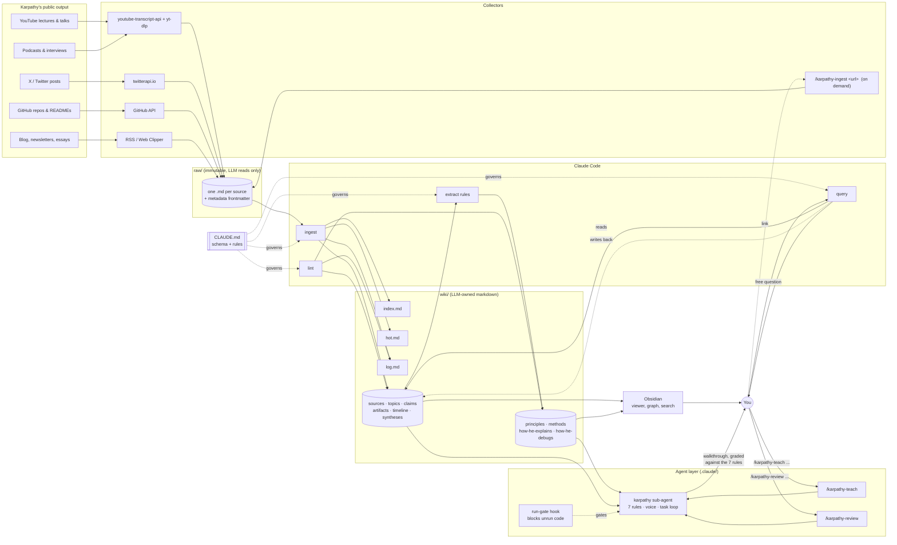
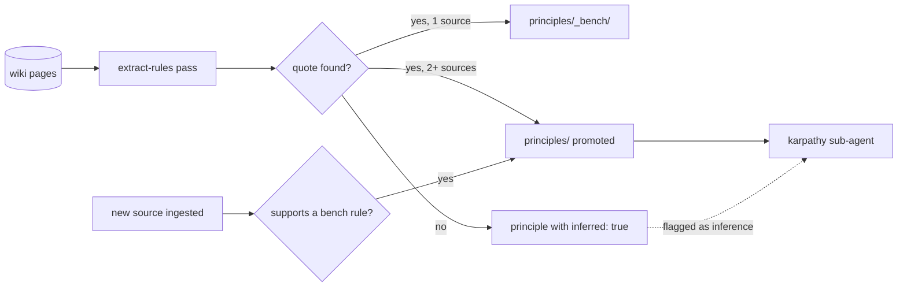
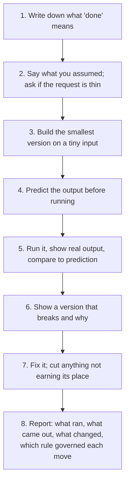
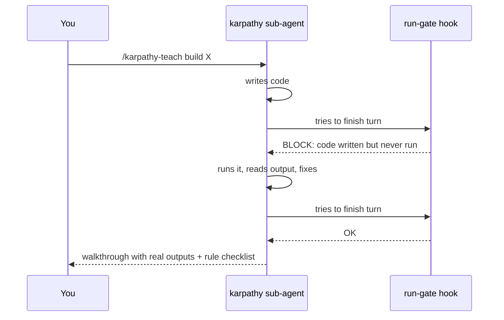
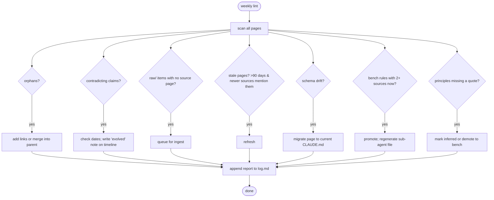
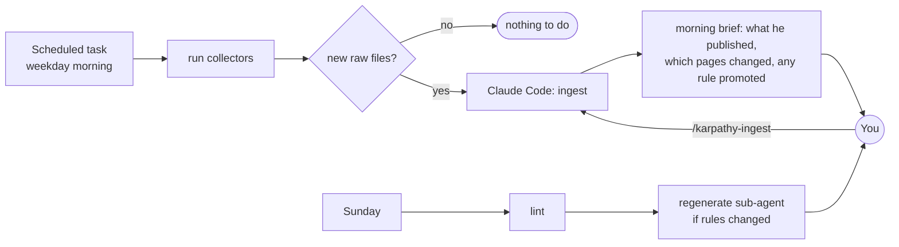

# Karpathy Wiki — Design

A personal, LLM-maintained wiki about Andrej Karpathy's ideas, code and teaching, plus an
agent that *teaches and reviews the way he does*. You ask questions; the agent answers from
a wiki it compiled from his public output (YouTube, X, GitHub, blog/newsletters, talks) and
follows rules extracted from his own words.

This follows Karpathy's own "LLM Wiki" pattern (April 2026): raw sources are immutable, the
wiki is owned by the LLM, a schema file tells the LLM how to write it, and three operations
(ingest, query, lint) keep it alive. On top of that we add a **rules layer**, a
**teaching sub-agent + skill**, and a **run gate** so the agent proves things instead of
claiming them.

**Four steps:**
1. Collect everything he has published into `raw/`.
2. Compile `raw/` into a linked wiki.
3. Extract his working rules from the wiki, each tied to a quote, and build an agent + skill on them.
4. Make the agent run before it talks (hook) and test it on real tasks.

---

## 1. The big picture



**Reading the diagram**

- Left to right is the direction of knowledge: Karpathy publishes, collectors fetch, the
  LLM compiles, rules get extracted, an agent uses them, you learn.
- `raw/` is the only place that holds his actual words. The LLM never edits it, so every
  wiki claim and every rule can be traced back and verified.
- `wiki/` is the compiled product: what he knows (topics, claims) **and** how he works
  (principles, methods). Think of it as the codebase; the LLM is the programmer; Obsidian
  is the IDE.
- The **agent layer** is what you talk to. It only knows what the wiki knows, and it must
  follow the rules the wiki extracted.
- `CLAUDE.md` is the constitution. Change the schema, and the next lint pass migrates pages.

---

## 2. Folder layout

```
karpathy-wiki/
├── CLAUDE.md                     # schema + operating rules for the LLM
├── DESIGN.md                     # this document
├── raw/                          # immutable source material (~700k words after backfill)
│   ├── youtube/                  # one .md per video: transcript + timestamps + metadata
│   ├── x/                        # one .md per post or thread (twitterapi.io, 2023→)
│   ├── github/                   # READMEs, key files, release notes per repo
│   ├── blog/                     # essays, newsletters
│   ├── talks/                    # transcripts of conference talks, podcasts
│   └── _manifest.json            # what has been fetched (dedupe + "what's new")
├── wiki/
│   ├── index.md                  # table of contents, grouped by page type
│   ├── hot.md                    # most recently changed pages + what changed
│   ├── log.md                    # append-only journal of every ingest / query / lint
│   ├── sources/                  # one page per raw item, links to everything it fed
│   ├── topics/                   # what he knows: tokenization, backprop, LLM OS...
│   ├── claims/                   # specific dated positions, with evidence
│   ├── artifacts/                # micrograd, nanoGPT, llm.c, nanochat...
│   ├── timeline/                 # how an idea evolved across years
│   ├── principles/               # the rules he works by (promoted, ≥2 sources)
│   ├── principles/_bench/        # candidate rules with only 1 source
│   ├── methods/                  # how-he-explains, how-he-debugs, how-he-builds
│   └── syntheses/                # answers you asked for, saved as pages
├── .claude/
│   ├── agents/karpathy.md        # sub-agent: 7 rules, voice, task loop
│   ├── skills/karpathy-teach/    # /karpathy-teach <topic or task>
│   ├── skills/karpathy-review/   # /karpathy-review <file or PR>
│   ├── skills/karpathy-ingest/   # /karpathy-ingest <url>
│   └── hooks/run_gate.sh         # Stop hook: block answers with unrun code
├── scripts/
│   ├── collect_youtube.py        # youtube-transcript-api + yt-dlp
│   ├── collect_x.py              # twitterapi.io
│   ├── collect_github.py         # GitHub API
│   ├── collect_blog.py           # RSS
│   └── run_ingest.sh             # feeds new raw files to Claude Code
├── tests/
│   └── prompts.md                # the real-task prompts used to validate the agent
└── .obsidian/                    # vault config (graph colours by page type)
```

---

## 3. Page types (the schema)

> `CLAUDE.md` is the authoritative schema. This table is a summary; where they differ,
> `CLAUDE.md` wins.

| Type | One page per… | Required frontmatter | Typical links |
|---|---|---|---|
| **source** | one raw item | `type, raw_path, published, medium, summary` | → every page it fed |
| **topic** | thing he knows (e.g. tokenization) | `type, aliases, first_seen, last_updated, sources[]` | → artifacts, claims, timeline, principles |
| **claim** | a specific stated position, dated | `type, stated_on, confidence, sources[]` | → topic; `supports:` / `extends:` / `contradicts:` other claims |
| **artifact** | repo, library, lecture series | `type, repo_url, language, status, sources[]` | → topics it demonstrates, methods it shows |
| **timeline** | evolution of one topic | `type, topic` | → claims in chronological order |
| **principle** | a rule he works by | `type, status (bench/promoted), quotes[] (text, source, location), inferred: bool` | → sources, methods, topics |
| **method** | a repeatable way he does something (explains, debugs, builds, reviews) | `type, steps[], sources[]` | → principles it applies, artifacts that show it |
| **synthesis** | an answer you asked for | `type, question, answered_on, sources[], rules_applied[]` | → whatever it cited |

Rules that apply to every page:

- Every factual sentence cites a `source` page, which cites a `raw/` file.
- Every **principle** carries at least one exact quote with its source and location (`mm:ss` or section).
  If the LLM is generalising rather than quoting, the page says `inferred: true` and
  the agent says so out loud when it uses that rule.
- A principle starts in `_bench/` with one source. It is **promoted** when a second
  independent source supports it. Lint checks for promotions and demotions.
- Wikilinks only (`[[Software 2.0]]`); no page may be an orphan after ingest.
- A claim that conflicts with an existing claim gets a `contradicts:` link, never a
  silent overwrite. Lint flags unresolved contradictions; the timeline page explains the
  evolution.

---

## 4. The rules layer (what makes it think like him)

The rules are extracted *from the wiki*, not written by hand. Prompt: "read principles,
methods and claims; propose the smallest set of working rules that explain how he builds,
teaches and reviews; each rule must have an exact quote and source, or be marked inferred".

Expected starting set (from his lectures, blog and posts; the extraction pass confirms,
reorders or rejects these against the actual sources):

| # | Rule | What it means in practice |
|---|---|---|
| 1 | Build it or you don't understand it | Reading is not understanding; write the minimal version. |
| 2 | First-order term first | Find the one piece that matters, show it working, add one thing at a time. |
| 3 | Predict, then run, then compare | State the expected number or behaviour before running; most bugs train fine but "silently work a bit worse". |
| 4 | Show the wrong version first | Leave the bug in, show why it breaks, then fix. |
| 5 | Prove it, don't claim it | "It works" needs the real output next to it. |
| 6 | Say what you assumed | Wrong unspoken assumptions are his top complaint about coding agents; ask when the request is thin. |
| 7 | Simpler wins | Cut what isn't earning its place. |

Each becomes a `principles/<slug>.md` page. The sub-agent reads the promoted set at start.



---

## 5. The agent layer

### 5a. Sub-agent: `.claude/agents/karpathy.md`

A separate Claude with its own context window, so your main conversation isn't dragged in.
Its file contains three sections, all generated from the wiki:

1. **Rules**: the promoted principles, each with its quote.
2. **Voice**: how he explains (from `methods/how-he-explains`): concrete before abstract,
   small numbers, show the tensor shape, name the gotcha.
3. **Task loop** it runs on every request:



### 5b. Skills

| Skill | You type | What happens |
|---|---|---|
| **/karpathy-teach** `<topic or task>` | "/karpathy-teach build a BPE tokenizer" | Hands off to the sub-agent, which runs the task loop and returns a walkthrough graded against a one-line-per-rule checklist. |
| **/karpathy-review** `<files, folder, or --staged>` | "/karpathy-review scripts/" | "Would he ship this? What would he delete?" Predicts failure modes, runs the code in those conditions, proposes the trimmed version, proves both behave the same side by side. |
| **/karpathy-ingest** `<url>` | "/karpathy-ingest https://x.com/karpathy/..." | Fetches to `raw/`, writes a source page, updates every page the source touches, checks bench promotions, updates index, hot and log. |

### 5c. Run gate hook: `.claude/hooks/run_gate.sh`

A `Stop` hook. When the sub-agent tries to end its turn, the hook checks whether the turn
wrote or edited code and whether any of it was executed. If not, it blocks the answer with
one message: "You have to run this before you say it works." The agent then runs, tests,
fixes, and only after that do you see the final answer.



---

## 6. The three wiki operations

### 6a. Ingest (new raw material → wiki)

```mermaid
sequenceDiagram
    participant S as Collector or /karpathy-ingest
    participant R as raw/
    participant L as Claude Code
    participant W as wiki/

    S->>R: write new source .md (frontmatter: url, date, medium)
    S->>R: update _manifest.json
    L->>R: read new/unprocessed sources
    L->>W: read index.md, hot.md + related existing pages
    L->>W: create or update topic / claim / artifact / method pages
    L->>W: create a source page linking back to raw/
    L->>W: add backlinks, update timeline pages
    L->>W: check principles/_bench: promote any rule this source supports
    L->>W: append to log.md, update hot.md and index.md
    Note over L,W: never edits raw/; never deletes a claim, only dates and links it
```

### 6b. Query (free question → answer from the wiki)

```mermaid
sequenceDiagram
    participant Y as You
    participant L as Claude Code
    participant W as wiki/
    participant R as raw/

    Y->>L: "How did his view on tokenization change?"
    L->>W: read index.md; open topic + timeline + claim pages
    opt detail missing
        L->>R: open the cited raw transcript for exact wording
    end
    L-->>Y: answer citing wiki pages and raw sources
    opt answer is reusable
        L->>W: save as syntheses/<question>.md, link it, log it
    end
```

The key difference from RAG: the LLM reads a few dense, already-organised pages instead of
re-chunking 700k words of transcript. Saved answers can make the wiki more useful over time,
but they can also compound mistakes, so a synthesis is never cited as evidence and its
claims must trace back to source pages.

### 6c. Lint (weekly health pass)



---

## 7. Collection and keeping it up to date

### Backfill (once)

One agent per source, run in parallel, each writing a manifest of what it fetched so you
can check coverage. Expect roughly 45–60 minutes and ~700k words. Ingest in batches of
20–30 sources so the schema can settle early.

| Source | How we collect | Cost | Notes |
|---|---|---|---|
| YouTube (his channel + talks he appears in) | `youtube-transcript-api` for captions, `yt-dlp` for metadata; Whisper fallback when captions are missing | free | long lectures chapter-split in raw/ with timestamps kept, so rules can cite `video@mm:ss` |
| X / Twitter | `twitterapi.io`, full archive since 2023 | ~$1 one-time, cents per update | threads stored as one file |
| GitHub | GitHub API: READMEs, release notes, commit messages of key repos | free | code is linked, not copied |
| Blog / newsletters | RSS; Obsidian Web Clipper for one-offs | free | karpathy.github.io, bearblog, any newsletter |
| Podcasts / interviews | yt-dlp or podcast RSS + Whisper | free | tagged `medium: talk` (covers talks, podcasts, interviews) |

### Ongoing



Two paths in: the scheduled collectors (daily) and you pasting a link (any time). Both end
in the same ingest, so the brain improves without you ever editing the wiki by hand.

---

## 8. Validation: how we know it works

Real tasks, not unit tests. These live in `tests/prompts.md` and are run after the build and
after any change to the rules or sub-agent.

| Test | Prompt | Pass when |
|---|---|---|
| Teach + build | `/karpathy-teach build a byte-pair tokenizer and teach me how it works` | Defines done first; smallest version on tiny input; predicts before running; shows real output; shows a broken version; final report maps each move to a rule. |
| Review | `/karpathy-review <a script that "works">` | Predicts a concrete failure condition, reproduces it by running, trims the script, proves trimmed and original behave the same side by side. |
| Run gate | Ask for code, then try to answer without running | Hook blocks; agent runs before answering. |
| Traceability | Pick any rule, click its quote | Opens the source page with timestamp or exact location; or the rule is marked `inferred`. |
| Learning | `/karpathy-ingest <new post>` | Source page created; touched pages updated; index, hot, log updated; any bench rule with a new supporting source is promoted. |
| Honest gaps | Ask something he has never addressed | Agent says the wiki has nothing and does not fabricate a position. |

---

## 9. Day to day

- **Learn**: `/karpathy-teach <topic>` for a walked-through explanation; free questions
  for "what does he think about X and how did it change".
- **Ship**: `/karpathy-review <file>` before client work goes out.
- **Grow**: paste a link with `/karpathy-ingest`; the morning brief tells you what he
  published and what changed in the wiki.
- **Browse**: Obsidian graph coloured by page type; follow timeline pages.
- **Reuse**: syntheses double as study notes and LinkedIn material.

---

## 10. Decisions

Resolved:
- **X collection**: `twitterapi.io` (cheap, full archive).
- **Transcripts**: YouTube captions via `youtube-transcript-api`, Whisper only as fallback.
- **Update cadence**: weekday morning collection + brief, Sunday lint, on-demand ingest.
- **Backfill scope**: 2023 onward first; older material (lectures, blog) can be added later with `/karpathy-ingest`.
- **Where it lives**: `karpathy-wiki/` is its own Obsidian vault.
- **Review skill**: on request only. `/karpathy-review` takes one file, several files, a
  folder, or `--staged` (what is about to be committed). A pre-commit hook can be added per
  repo later; it would call the same skill on the staged files.

All design decisions are resolved. Next: write the specs (`specs/`), then build phase by phase.
